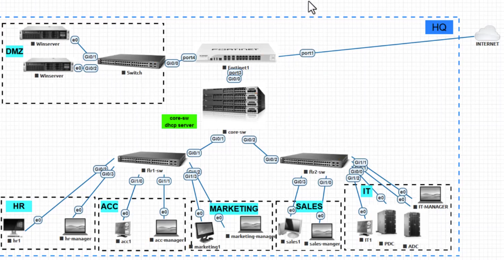
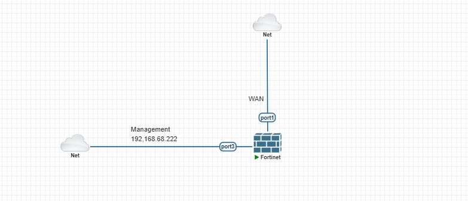

# About AM Networks

AM Networks is a mid-sized enterprise operating across multiple sites. The company requires a secure network topology and supporting systems that protect the confidentiality, integrity, and availability of its data and services.

# Goals of the project

This project provides hands-on experience in designing and implementing secure enterprise networks, including network segmentation, inter-site connectivity, and security controls.

# Project Requirements

- **Departmental Isolation & Segmentation**: Logical separation of business units into dedicated 802.1Q VLANs (HR, IT, Finance, Management, Data Center/Servers, Sales, Support, and Guest).
- **Inter-VLAN Routing & Boundary Defense**: Centralized gateway routing handled directly by FortiGate NGFWs (FG1 and FG2) using sub-interfaces (Router-on-a-Stick) to enforce strict inspection on all inter-department traffic.
- **Encrypted Site-to-Site Transport**: Implementation of a high-availability, standards-based IPsec VPN (IKEv2) across the simulated public WAN/Cloud infrastructure.
- **Granular Security Policies**:Guest network must have direct Internet/cloud egress only, with complete isolation from all internal corporate subnets.
    - IT and Management zones require controlled administrative access (SSH, HTTPS) to network devices and servers.
    - Finance and HR VLANs must be restricted to authorized application servers and denied direct access to Sales/Support workstations.
    - Cross-site access over IPsec must be strictly limited to approved business subnets and services.

# Key Deliverables

- **Network Architecture & Addressing Plan**: Comprehensive IP schema covering all subnets, VLAN IDs, gateway assignments, and IPsec tunnel overlay networks.
- **Switching Configuration Scripts**: Hardened Cisco IOU configurations including access port security, trunk encapsulation, native VLAN assignment, and STP parameters.
- **FortiGate NGFW Configuration Files**:
    - Logical sub-interface setups (VLAN tags, gateway IPs, DHCP pools).
    - Route-based IPsec Phase 1 & Phase 2 cryptographic proposals (AES-256, SHA-256, DH Group 14/19).
    - State-aware firewall policy rulesets for intra-site, inter-VLAN, and cross-site VPN traffic.
- **Testing, Verification, & Validation Matrix**: Detailed test cases demonstrating successful segregation, policy enforcement, encrypted tunnel establishment, and unauthorized traffic drops.
- **As-Built Topology Diagram**: Detailed visual schematic illustrating Layer 2 domains, Layer 3 gateways, interface numbering, and tunnel termination points.

# Goal Topology

# Current Topology

# Tools used

- VMWare
- PNETLAB
- FortiGate 7.6